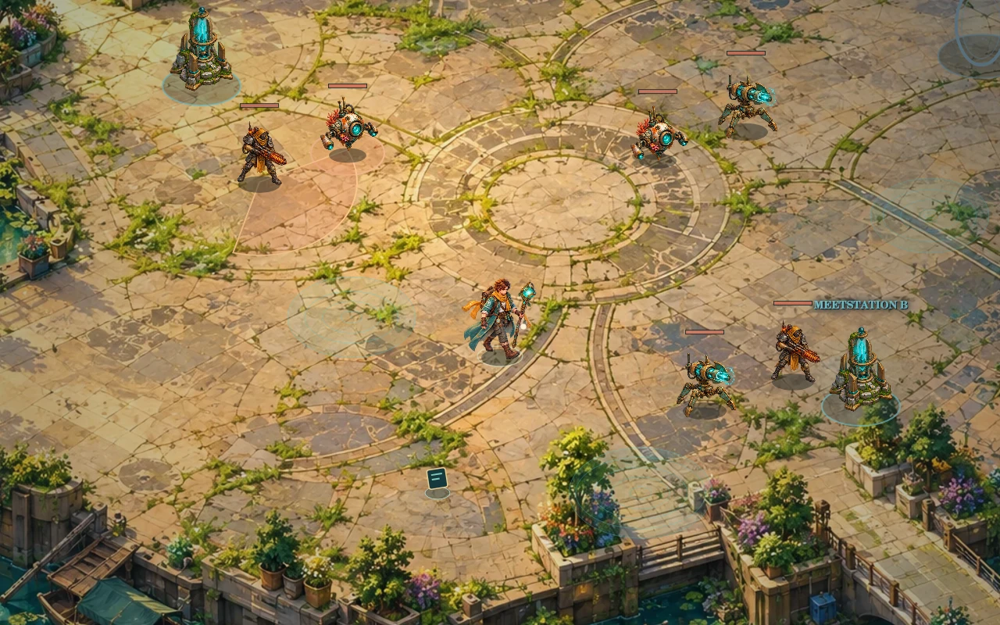

# Gouden Horizon — Aurelia



Een zelfstandig **2.5D action RPG** in een door klimaatontwrichting opgebroken Nederland. Verken zestien verbonden gebieden, bouw je eigen veldpak en verbind drie kalibratiekernen met het herstelnet Aurelia.

**Versie 5.3** geeft de veilige handelsposten vaste, afzonderlijke poorten: turquoise voor arena’s, goud voor meetstations en een doorgang voor de volgende regio. Een poort verandert nooit van bestemming. De campagne blijft zestien hoofdstukken volgen en arena’s houden hun bestaande open gevechtsvloer en één terugpoort na volledige overwinning.

Vier nieuwe vijandrollen voegen snelle boogjagers, gravende asvijanden, schildrovers en stormnesten toe. De drie kerngebieden eindigen met eigen bazen: de Getijdenmaaier, Spiegelvorst en het Kiemhart. Iedere regiobaas heeft drie aanvalspatronen en een tweede fase. De laatste Gouden Wachter houdt zijn drie fases.

De vier handelsgebieden zijn volledig veilig. Mara verkoopt focussen en relikwieën, Jules verkoopt veldpakken en verband, Inez versterkt je uitrusting. Verken zijpaden voor eenmalige voorraadkisten. Legendarische items hebben zes unieke effecten; bijzondere vondsten krijgen een lichtkolom, eigen geluid en een korte melding met hun itembeeld. Betere buit blijft schaars, met een bescherming tegen vier opeenvolgende grote beloningen zonder Legendary.

**Versie 5.4** voegt een echte geschilderde loopatlas toe: acht kijkrichtingen met elk zes frames. Armen, romp, mantel en benen veranderen samen van houding. De actuele looprichting bepaalt de sprite; achteruit richten tijdens lopen draait de benen niet om. De cyclus volgt afgelegde afstand, versnelt met snelheidsgear en stopt tegen een muur. Voetankers, korte richtingsblends en een aan de geschilderde focus gekoppelde gloed houden de animatie op de grond.

Boogjager, Asgraver, Schildrover en Stormnest hebben nu eigen sprites. De Getijdenmaaier, Spiegelvorst en het Kiemhart hebben elk eigen artwork en een aparte aanvalshouding. De ongelijke bronatlassen worden met daadwerkelijke silhouetgrenzen uitgesneden; runtime-clipping houdt naastliggende sprites buiten de uitsnede.

Iedere opgepakte vondst, ook uit een kist, geeft een bevestiging met een kort statverschil ten opzichte van het gedragen slot. Kistkeuzes tonen vooraf winst, verlies, unieke effecten en eventuele levelvereisten. Er is geen automatische gearscore of automatische uitrusting: een hogere zeldzaamheid kan nog steeds een minder passende build zijn. De dropkansen, economie, vijandschaling en bestaande arena-layouts van 5.3 blijven behouden.

**Versie 5.4.1** maakt de Getijdenkade ruimer. Mara staat op het aankomstplein, Jules op het tuinterras en Inez op de rechtersteiger. De hoofdroute blijft vrij van marktkramen. Beide trappen hebben ruimere aansluitingen; de twee kisten staan op bereikbare plekken, los van de handelaren. De minimap toont iedere handelaar. Bestaande saves krijgen dezelfde indeling zonder geopende kisten, winkelvoorraad of uitrusting opnieuw te vullen. Een save buiten de opnieuw getraceerde trapvloer hervat op de dichtstbijzijnde vrije vloer.

**Versie 5.4.2** herstelt de loopgrenzen op beide zichtbare zijtrappen. De rechter trap heeft een doorlopende aansluiting voorbij de oude weggrens; het tuinterras gebruikt de volledige vloerbreedte. Een extra regressiecheck loopt met vaste S- en S+D-invoer via de linker-, midden- en rechterkant van beide trappen, heen en terug, zonder routeberekening.

## Lokaal spelen

Gebruik Node 18+:

```bash
npm start
```

Open [http://localhost:8080](http://localhost:8080). Er zijn geen npm-dependencies nodig. Gebruik de webserver voor ES-modules en assetverzoeken.

## Besturing

| Invoer | Actie |
| --- | --- |
| WASD / pijlen | Bewegen |
| Muis + links vasthouden | Richten en je gekozen hoofdaanval herhalen |
| 1 t/m 6 | Toegewezen vaardigheid direct uitvoeren; vasthouden herhaalt |
| Klik op hotbar-slot | Schietskill: laatste handmatige richting. Zon/AoE: nabij doel |
| Rechtsklik op hotbar-slot / Q-slot | De aanval voor dat specifieke slot wijzigen |
| Klik op LINKS in de HUD | De hoofdaanval kiezen |
| Q / rechtsklik | Je zelf toegewezen rechter vaardigheid |
| K / klik op level | Skills leren; eerst links, rechts of een cijfer kiezen, daarna een aanval |
| Muiswiel | Hoofdaanval wisselen tussen geleerde aanvallen |
| Spatie / E | Ontwijken; twee ladingen, kort onkwetsbaar |
| H | Verband: 45 leven en statusherstel |
| R | Volledig geladen kernpuls |
| F | Handelaar, portal, station, vondst, archief of console gebruiken |
| B / handelsknop | Winkel openen bij een handelaar |
| I | Rugzak, vergelijking en handmatig uitrusten |
| M | Kaart; vrijgespeelde bestemming voor de richtingpijl kiezen |
| Esc | Pauze of een vrijblijvend menu sluiten |
| Touch | Stick om te bewegen; doelknop voor vuur en automatisch richten |

Cijfers en rechtsklik veranderen je hoofdaanval **niet**. Je kunt bijvoorbeeld water op links houden, IJslans op rechts plaatsen en Stormfront op slot 4 uitvoeren.

## Wereld en voortgang

De vaste volgorde is: **Getijdenkade → Rietdelta → Verdronken Ring → Zonnetuinen → Transportnet → Spiegelvelden → Zoutcentrale → Rode Kilometer → Groene Corridor → Kasfront → Zoutwoud → Zaadkluis → Noordzeebrug → Stormhaven → Wolkenarchief → Aurelia-spits**.

Elke stap levert iets voor de volgende op: de pomp voor de meetstations, een droge routekaart, zonne-energie, een watervoorraad, kiemculturen en de laatste weermeting. De kaart toont de hoofdstukken in volgorde en blokkeert overslaan. Na gevechtschapters keer je met de enige doorgang terug naar de regionale handelspost. Diezelfde post heeft vaste, duidelijk verschillende poorten; alleen het volgende verhaaldoel en eerder bezochte doelen zijn bereikbaar. In de Zonnetuinen en Zaadkluis moet de bewaakte protocolkist worden geborgen of gerecycled voordat je verder kunt.

De vier regionale handelsgebieden zijn volledig veilig en hebben drie gespecialiseerde handelaren en eenmalige verkenningsvondsten. Zonnetuinen en Zaadkluis hebben een veilige aankomstplek, maar daarbuiten liggen routegevaren en bewakers. De drie kernarena’s hebben twee stations met elk twee golven en een unieke regiobaas. De zes andere gevechtschapters hebben twee groepen met een elitebewaker. Alle vijanden moeten worden verslagen voordat de terugdoorgang verschijnt. De laatste Wachter heeft drie fases; na de eindconsole kun je terug naar het handelskamp.

Kies met M het volgende doel voor de richtingpijl en loop naar de bijbehorende vaste poort. Vanuit een veilige handelszone kun je via M meteen naar voltooide hoofdstukken terugreizen. Vanuit een arena ga je eerst terug naar de post. In een arena ga je eerst terug naar het kamp. Kies **Volg het verhaal** om een oude bestemming los te laten. Verslagen vijanden, geopende vondsten, winkelvoorraad en voltooide stations blijven bewaard. Oude gebieden genereren geen nieuwe vijanden of gratis buit. Reizen geeft geen gratis leven of mana. Een voltooid station biedt één herstelbeurt.

## Vaardigheden en uitrusting

Elk nieuw level geeft **één punt**, met een duidelijke gouden melding, lichteffect en oplopend geluid. Het gepauzeerde keuzescherm toont het bereikte level, je punten en de vaardigheden die net beschikbaar zijn gekomen. Kies een nieuwe skill of een permanente verbetering, of bewaar het punt. Looptempo, schade, leven, mana en ontwijkherstel zijn build-keuzes.

| Vaardigheid | Werking | Beschikbaar |
| --- | --- | --- |
| Getijdenwaaier | Drie waterbogen; maakt doelen nat | Start |
| Boogbliksem | Directe straal; ketent via natte doelen | Start |
| Zonnebom | Gebogen worp, explosie en kort vuurveld | Start |
| IJslans | Doorboren, vertragen en natte doelen bevriezen | Level 2 |
| Windboemerang | Raakt heen en terug; duwt weg | Level 3 |
| IJsbarrière | Smalle strook dwars op je richting; vertraagt en bevriest natte doelen | Level 3 |
| Zwaartekern | Trekt samen en implodeert | Level 4 |
| Cycloon | Smalle, voortbewegende tornado die vijanden meesleept | Level 4 |
| Stormfront | Maximaal drie gerichte inslagen per salvo; wisselt doelen af en ketent via water | Level 5 |
| Zonneval | Drie afzonderlijke kraters na 0,6 / 1,35 / 2,1 seconden | Level 6 |

Nieuwe skills kosten één punt en kunnen op links, rechts/Q en alle zes cijfer-slots worden geplaatst. Het menu toont acht slotkaarten: kies eerst het slot, daarna de aanval. Een beschikbare nieuwe skill kan met één punt worden geleerd en meteen geplaatst. Een dubbel geplaatste aanval deelt zijn cooldown tussen knoppen. De standaard rechter aanval is Boogbliksem, of Zonnebom wanneer je start met storm. Getij → storm geeft +70% schade en kettingbliksem; getij → zon geeft een stoomgolf. De kernpuls bouwt een zichtbare kern op en raakt na een halve seconde meerdere doelen met een brede golf. Deze aanval laadt zichzelf niet op. De opbouw door schade, kills en combinaties is gehalveerd; overkill telt niet mee. Na gebruik geldt 40 seconden herlaadtijd, zichtbaar naast de lading in de HUD.

Je draagt **focus, mantel, relikwie, laarzen, handschoenen en gordel**. Er zijn 36 buittemplates met willekeurige eigenschappen, itemlevels en vijf zeldzaamheden: **Common, Uncommon, Rare, Epic, Legendary**. Common heeft geen extra eigenschap, Uncommon en Rare één, Epic en Legendary twee. Hogere itemlevels en zeldzaamheden versterken stats. Sommige items vragen een hoger spelerslevel.

Nieuwe items gaan eerst in de rugzak van maximaal 48 onderdelen. Kies het onderdeel, vergelijk het met het passende gedragen slot en klik op **Uitrusten**. Het vorige item blijft in je rugzak. Wisselen behoudt je HP- en mana-percentage. Recyclen en verkopen zijn expliciete, afzonderlijke acties.

## Handel en lootprogressie

Elke handelspost heeft acht blijvende aanbiedingen, verdeeld over Mara (focus, relikwie, handschoenen) en Jules (mantel, laarzen, gordel), met betere itemlevels in latere regio’s. Inez beheert de werkplaats. Kopen plaatst een item in de rugzak. In Verkopen filter je op uitrustingstype en zeldzaamheid, selecteer je meerdere items of alle zichtbare items en zie je vooraf het totaal. Eén actie verkoopt de selectie; gedragen gear kan niet worden geselecteerd. Verkopen betaalt 30% van de basisprijs plus een kleine vergoeding voor versterkingen; uitgeruste spullen moeten eerst worden gewisseld. Recyclen geeft minder schroot dan verkopen.

De smid versterkt elk gedragen onderdeel tot **+3**. Een focus krijgt schade, een mantel leven, een relikwie manaherstel, laarzen snelheid, handschoenen kritieke kans en een gordel bescherming. De prijs stijgt per versterking. Verband kost 15 schroot, met maximaal acht ladingen. Handelen kan alleen in een veilige zone.

| Vijand / vondst | Kans op een item | Common / Uncommon / Rare / Epic / Legendary bij itemlevel 1 |
| --- | --- | --- |
| Schrootschraper | 7,7% | 70 / 27 / 3 / 0 / 0 |
| Inspectiedrone | 9,1% | 60 / 32 / 8 / 0 / 0 |
| Asjager | 14,7% | 30 / 40 / 26 / 4 / 0 |
| Hitteschild | 19,3% | 12 / 35 / 40 / 13 / 0 |
| Hydraulische Breker | 25,2% | 0 / 20 / 45 / 32 / 3 |
| Boogjager | 14% | 28 / 43 / 25 / 4 / 0 |
| Asgraver | 17% | 14 / 38 / 36 / 11 / 1 |
| Schildrover | 19% | 13 / 35 / 39 / 12 / 1 |
| Stormnest | 23% | 5 / 27 / 45 / 21 / 2 |
| Elite | 60% | 0 / 12 / 48 / 35 / 5 |
| Kernbewaker | 100% | 0 / 0 / 50 / 43 / 7 |
| Regiobaas / eindbaas | 100% | 0 / 0 / 22 / 53 / 25 |

De kansen gelden voor een lege vloer. Naarmate er meer losse items liggen, neemt de kans verder af; bij zeven losse items vallen geen extra gewone drops. Bewakers en bazen behouden hun gegarandeerde item. Bij elke vierde grote drop is een Legendary gegarandeerd als de vorige drie grote drops er geen hadden. Opgeroepen versterking levert geen XP, schroot, items, kill-healing of kill-lading, en een nest roept maximaal drie keer versterking op. De percentages rechts gelden als er een item valt. Vanaf itemlevel 5 verschuift bij gewone vijanden een deel van Common naar Rare. Vijandfamilies hebben ook voorkeuren voor slots: schrapers laten vaker laarzen, gordels of focussen vallen; schilden en brekers vaker bescherming. De volledige tabellen staan in `src/loot.js`.

Er zijn 21 vijandtypen, inclusief vier bazen. De nieuwe Boogjager, Asgraver, Schildrover en Stormnest hebben eigen gedrag; de kerngebieden worden bewaakt door de Getijdenmaaier, Spiegelvorst en het Kiemhart. De eerdere families zijn drones, rovers, wortelwachters, geschut, schrapers, sluipschutters, schilden, sporendragers, stormkwallen, brekers, magneetkrabben, resonanten en pekelbrekers. Vastgelegde vuurlijnen, landingscirkels en opbouwende waarschuwingen geven tijd om te ontwijken. Schrapers wisselen beten af met een vast gerichte sprint. Hitteschilden wisselen hun nabijslag af met een uitdijende schokgolfrand; het midden blijft veilig. Asjagers bewaren afstand en wisselen hun precisiestraal af met drie snelle projectielen. Drones zigzaggen rond hun doel, stormkwallen cirkelen en brekers blijven op artillerieafstand.

Elke nieuwe vijandgroep legt zijn kracht vast op basis van regio en spelerslevel: meer leven en schade, iets hogere snelheid en kortere pauzes. Uitgeputte oude vijanden herstellen niet bij terugreizen of gearwissels. Oude saves behouden hun schadepercentage bij de eenmalige balansmigratie.

Legendary-effecten: een extra ijsstraal na vier directe casts, een schild van 16 na ontwijken, één extra stormsprong, een vertragend ijsspoor, een kleine explosie na een brandende kill en 12 mana na schade. Elk effect heeft een eigen cooldown of triggerdrempel; effecten kunnen zichzelf niet onbeperkt activeren.

## Geluid

Het spel maakt zijn muziek en effecten zelf met Web Audio: een rustige originele harmonische cyclus, warme gefilterde klanken, zachte belnoten en ruimtelijke nagalm. Gevechten voegen een lage spanningspuls toe. Elke regio heeft een andere grondtoon. Het volume van de achtergrond blijft lager dan de effecten. Er zijn geen externe muziekopnames of samples gebruikt. Geluid begint na je eerste spelklik; de luidsprekerknop schakelt alles uit of weer in. De bron en het zelfgegenereerde geluid vallen onder de meegeleverde `LICENSE`.

## Opslag en checkpoints

Oudere saves hervatten na de laatst geborgen kern en behouden hun uitrusting en verslagen vijanden. Iedere aankomst vormt een checkpoint. Handel en versterkingen leggen eveneens een checkpoint vast, zodat aankopen en verkochte voorraad bij uitval niet worden teruggedraaid. Uitval herstart het huidige gebied vanaf dat checkpoint. Normaal terugreizen behoudt actuele voortgang.

Voortgang wordt iedere acht seconden en bij belangrijke keuzes in `localStorage` opgeslagen. V3-, V4- en V5-saves migreren automatisch, inclusief bestaande uitrusting en voortgang. V3 geeft alsnog skillpunten voor eerdere levels. Oudere bezochte gebieden blijven toegankelijk. Opslag geldt voor deze browser en dit domein.

## GitHub Pages en Render

Upload de inhoud van deze map naar je GitHub-repository. Kies bij **Settings → Pages** je branch en rootmap. Relatieve assetpaden werken ook op project-URL’s. `.nojekyll` is inbegrepen.

Voor Render: maak een **Static Site**, of gebruik `render.yaml` als blueprint.

| Instelling | Waarde |
| --- | --- |
| Build command | `npm test && npm run site:build` |
| Publish directory | `dist` |

Er is geen database, servercode of geheime configuratie nodig.

## Validatie en code

```bash
npm test
npm run site:build
```

104 regeltests controleren gevechten, terrein, golven, alle verbindingen, opslag, migraties, handel, itemverdeling, versterkingen, veilige zones, gescheiden invoer, gebiedsschade en de kernpuls. Drie volledige campagnes gebruiken normale acties met alle startdisciplines: zestien gebieden, skills leren, gear plaatsen, kopen/verkopen/versterken en alle baasfases. De simulator geeft geen gratis stats of unlocks en verwijdert geen vijanden. Bij verlies gebruikt hij maximaal twee normale checkpoint-herstarts; het aantal herstarts staat in het testresultaat.

De echte Canvas-renderer is met gedecodeerde art gecontroleerd: zestien gebieden, tien aanvallen, nieuwe vijanden, buit, kampen en de kernpuls. Het echte entrypoint is daarnaast in een minimale DOM getest, inclusief menu’s, slots, rechtsklik, winkelknoppen, saves en herstarten. Browser-layout, echte audio-uitvoer en mobiele framerate zijn niet handmatig getest. De automatische speler slaat leestijd over; zijn tijd is geen beloofde menselijke speelduur.

| Bestand | Doel |
| --- | --- |
| `src/engine.js` | Gevecht, AI, navigatie, voortgang en opslag |
| `src/expedition.js` | Handel, veilige kampen, locks, AoE en kernpuls |
| `src/hero-animation.js`, `src/hero-motion.js` | Acht geschilderde looprichtingen, afstandscyclus, voetankers en focusgloed |
| `src/gear-feedback.js` | Echte statverschillen bij vondsten en kistkeuzes |
| `src/story.js`, `src/aim.js` | Chronologische hoofdstukken en handmatig/ondersteund klikrichten |
| `src/enemy-variety.js` | Mijnen, magnetische trek, sweep, pekel en zoutbarrières |
| `src/hubs.js` | Vaste hubpoorten, drie diensten en verkenningskisten |
| `src/encounters.js`, `src/encounter-visuals.js` | Nieuwe rollen, regiobazen en aanvalspatronen |
| `src/legendary.js` | Zes unieke effecten met cooldowns |
| `src/balance.js` | Eenmalige schaling van vijanden zonder genezing |
| `src/loadout-ui.js` | Acht onafhankelijke slotkeuzes |
| `src/loot.js` | Lootprofielen, rollen, itemstats en migratie |
| `src/data.js` | Gebieden, loopvloeren, skills en verhaal |
| `src/render.js`, `src/visuals.js` | Camera, sprites, effecten, portals en minimap |
| `src/main.js`, `src/shop-ui.js` | Invoer, HUD, journal, winkel en saves |
| `src/sound.js`, `src/score.js` | Originele zachte muziek, nagalm en effecten |
| `styles.css` | Responsive perkament-, leer- en messinginterface |

## Artwork en licentie

Titelart, zestien omgevingen, heldanimaties, vijandatlassen, items, skills, portals, handelaar, effecten en UI-texturen zijn voor dit project met AI gegenereerd. Er zijn geen assets uit Nine Parchments, Torchlight of andere spellen overgenomen. De wereld gebruikt Canvas met geschilderde 2.5D-art; het is een vaste campagne, geen volledige 3D-engine of procedureel dungeonstelsel.

Sprites zijn lossless WebP met transparantie, eigen voetankers, schaduwen en dieptesortering. Runtime-art en bronatlassen zijn samen circa 30 MB. De drie v5.4-artprompts staan in `assets/expedition/V54-ART-PROMPTS.json`. De 48 hero-uitsneden staan in `assets/painted/hero-eight-directions.json`, de vijand- en baasuitsneden in `assets/expedition/v54-sprites.json`. De vier v5.2-artprompts en uitsneden staan in `assets/expedition/V52-ART-PROMPTS.json` en `V52-ART-CROPS.json`; overige prompts staan in `assets/painted/`, `assets/items/ART-PROMPTS.json` en `assets/expedition/ART-PROMPTS.json`. Code en meegeleverde assets vallen onder `LICENSE`.
